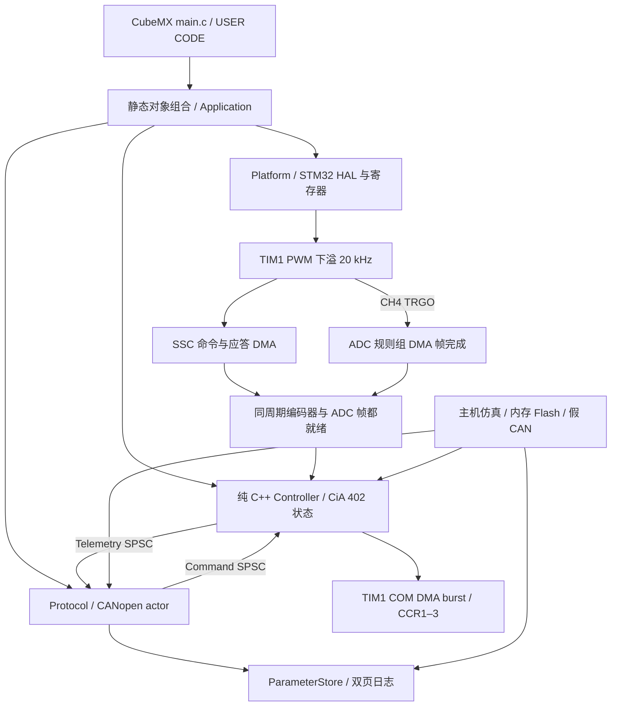

# 架构与并发

## 分层

`Application/include/roller` 无 HAL/FreeRTOS 依赖，包含控制算法、驱动状态机、固定容量队列和参数日志。`Platform/STM32` 负责板级 I/O；`Protocol/CANopen` 负责帧与对象字典，不能直接改 ISR 内控制器的状态。`application.cpp` 是唯一组合入口，将真实实现注入各接口。

架构借鉴参考 WSL 模板的模块生命周期和失败回滚原则，针对 32 KiB SRAM 使用静态实例，不引入动态工厂、运行时服务定位器或通用事件总线。

## 设计模式的具体用途

| 机制 | 作用 |
|---|---|
| Template Method：`Module::start/stop` | 统一初始化、清理和状态转换，避免不同模块各自遗漏失败路径 |
| 固定容量 `ModuleManager` | 按依赖顺序启动，逆序停止；清理失败时保留依赖，不继续释放仍可能被使用的对象 |
| 状态机 | 明确驱动的 disabled / ready / switched-on / enabled / quick-stop / fault 状态 |
| Adapter / 依赖注入 | CANopenNode 的 C 端口映射到 C++ Board；参数存储映射到 STM32 Flash 或测试内存 |
| 三角函数策略 | 主机使用标准库，STM32 注入 CORDIC sin/cos；输入与结果经 DMA 搬运，运行时仅控制回调持有 CORDIC |
| `ValidatedCommand` 值类型 | CAN 任务完成范围验证后才能进入命令队列，ISR 接收不可变的已校验副本 |
| 单任务协议处理 | CANopen 所有对象由一个任务持有，OD、SDO、PDO、EMCY 不跨线程直接访问 |
| SPSC 邮箱 | 在明确的单生产者/单消费者边界传递完整值对象 |
| 双页提交日志 | 电源中断时保留上一次已提交配置 |

接口不拥有实现对象，因此基类析构受保护，禁止通过基类指针 delete。模块与 RTOS 任务包装器不可复制；任务、TCB、栈、OD、CAN 缓冲区和控制器均静态分配。C++23 用于 `std::expected` 等可读错误传播；不使用异常、RTTI、协程堆帧、动态容器或全局 new。最终 ELF 检查禁止链接分配器。

## 调度与中断

| 执行单元 | 频率 / 优先级 | 内容 |
|---|---|---|
| EXTI0 | NVIC 1 | nFAULT 立即拉低 PB2，设置原子故障位 |
| TIM1_UP_TIM16 | 20 kHz / NVIC 2 | PWM 下溢周期边界处理命令，启动本周期 SSC DMA |
| DMA1_Channel1 | 20 kHz / NVIC 2 | ADC 规则组循环 DMA 半满/全满回调，复制完整四通道帧并准备电流与低频采样结果；编码器已完成时直接执行控制 |
| DMA1_Channel2 | 每个 SSC 事务两次 / NVIC 2 | SPI RX：命令完成后切换 DATA 方向并接收角度与 safety；应答完成后记录本周期角度，ADC 帧已就绪时执行控制 |
| DMA1_Channel3 | 错误时 / NVIC 2 | SPI TX DMA 传输错误处理 |
| ADC1_2 | 错误时 / NVIC 2 | ADC overrun 等错误关桥并锁存故障 |
| FDCAN1_IT0 | NVIC 6 | 最多提取 3 个硬件 FIFO 帧，进入容量为 32 的 SPSC 队列 |
| CANopen task | 1 ms / RTOS 3 | 最多派发 64 帧，SDO/NMT/SYNC/RPDO/TPDO、发布命令 |
| Supervisor task | 10 ms / RTOS 2 | 检查 ADC 与 CAN 任务均前进，喂 IWDG，读按钮和栈高水位 |
| TIM6 | 1 ms / NVIC 15 | 仅 HAL tick |
| SysTick/PendSV | NVIC 15 | 仅 FreeRTOS |

高优先级 TIM1、ADC、DMA、EXTI 不调用任何 RTOS API。TIM1、ADC 与 SPI DMA 中断优先级相同，按周期交接采样和控制状态；ADC 准备数据时不会被 SPI 完成中断抢占。每周期只合并该周期的编码器结果与 ADC 帧，下一周期触发时前一事务仍未消费或未完成则关桥并报时序故障。CAN 的全部库回调在 CAN 任务内执行，因此 CANopenNode 的锁宏为空；这项约束不是“任意线程都安全”的声明。更换执行模型时必须同步重做锁与数据所有权。

命令和遥测使用 release/acquire 的 32 位 lock-free 原子索引，不是 `volatile` 共享结构体。队列满时命令方向触发故障并禁止功率输出；遥测可丢弃旧采样，接收端使用最新完整值。硬件错误、队列溢出和按钮通过原子通道请求故障，ISR 独占控制器内部状态。

板级输出在启用 PB2 前有界等待 PWM DMA burst 完成，最多等待 320 个 DWT 周期，并再次检查 nFAULT、异步故障和 inhibit，防止 EXTI 抢占后旧控制结果重新开桥。ADC 帧回调间隔超过 75 µs（功率开启时），或从 ADC DMA 帧回调入口到控制及输出结束超过 45 µs，则关桥。`0x2100:0A` 报告后者的历史最大 DWT 周期数，包含 ADC 回调后尚未完成的 SSC 等待与中断延迟，不包含 ADC 回调之前已完成的编码器传输。阈值检查不能替代示波器/DWT 实测，特别是 Debug、Flash 操作与其他中断同时发生时。

IWDG 约 250 ms，只有 ADC 与 CAN 任务都持续工作才刷新。监督检测到停滞后锁住 inhibit 并停止喂狗；重启不恢复运行命令。Debug 配置冻结 IWDG 方便诊断，断点本身不是停机手段，带电调试前必须先关桥。

Flash 保存先关桥，再暂停 TIM1、ADC 与各 DMA 请求，清除未完成的 SSC 事务；重启时先准备 DMA 并启动首个编码器事务，再启动 PWM 定时器。TIM1 的 UG 初始化完成后才允许 update 中断，后续自然下溢每 50 µs 启动一次编码器读取。恢复采样时递增 sampling epoch，监督器重新建立一次进度基线，下一周期仍须观察到两个执行单元前进。周期任务错过截止时间后跳过过期周期，避免连续补跑而触发队列溢出或虚假的停滞。这个例外仅覆盖明确的采样重启，inhibit 仍无条件禁止输出。

## DMA 数据路径与所有权

TIM1 周期下溢时先启动本周期编码器 DMA；以该时刻为 0，CH4 在约 23 µs 触发 ADC1 规则组，四路转换约 26.7 µs 完成。规则组按 A/B/C 电流、母线电压扫描，循环 DMA 缓冲区容纳两个完整帧。半满和全满中断各对应一帧，控制层只复制 DMA 当前未写入的半区，并检查复制前后的传输位置。ADC 回调准备电流、母线与低频采样结果后，与本周期编码器结果汇合：编码器已完成则在 ADC DMA 中断执行控制，否则由最终 SPI RX DMA 中断继续。编码器读取早于相电流采样，间隔为一个 PWM 周期的一部分；当前实现没有角度外推，不能将这两次采样视为同时发生。

内部温度与 VREFINT 使用软件触发的两路注入序列，每 2000 帧启动一次，在随后帧检查完成并读取；注入组没有原生 DMA 请求。

SSC 使用持久缓冲区完成命令一字及应答两字的 TX/RX DMA。命令完成后确认 SPI BSY 清除、将 PA7 切换为输入，保留 200 ns turnaround，再开始应答；最终 RX 完成后恢复 CS 和 PA7。CRC 与 safety 校验保留。运行时不轮询整个 SPI word，仅在 DMA 阶段交接时有界等待 BSY 尾部清除；启动检查仍等待异步事务结果，并设总超时。

SVPWM 的占空比以 C/B/A 顺序写入固定 DMA 源缓冲区，由软件 COM 事件触发 TIM1 DMAR burst，一次填充 CCR1–3 的预装载寄存器，CCR4 保持采样触发配置。使用 COM 使三路预装载在下一自然 update 前准备完毕；前一 burst 未完成时不得覆盖源缓冲区。CORDIC 的两字输入和两字结果由独立 DMA 通道搬运，调用方有界等待完成。

| DMA1 通道 | 请求 / 数据 | 配置所有者 |
|---|---|---|
| Channel1 | ADC1 DR → 两帧循环缓冲区 | CubeMX ADC/DMA 配置，Board 管理启停与消费 |
| Channel2 / Channel3 | SPI1 RX / TX，SSC 命令与应答 | `Platform/STM32/ssc_dma.cpp` |
| Channel4 | TIM1 COM → DMAR，CCR1–3 burst | `Platform/STM32/pwm_dma.cpp` |
| Channel5 / Channel6 | CORDIC READ / WRITE | `Platform/STM32/cordic_math.cpp` |

以上通道及对应 DMAMUX 通道由板级实现保留，CubeMX 新增外设时不得重复分配。FDCAN 没有本芯片可用的 DMA 请求，仍由 CPU 读取硬件 FIFO/message RAM，再交给 CAN 任务。

## 控制与坐标

电角度 `wrap(direction × pole_pairs × encoder_angle - electrical_offset)`。A/B/C 相使用三路 Clarke，旋转到 dq；Id 目标为 0，Iq 来自 1 kHz 运动环。PI 采用条件积分与矢量限幅反馈，电压矢量最多 4 V 或母线的 40%，取较小值。

位置和速度对外使用经 direction 修正的转数与转/秒。编码器使用整数圈数加当前绝对角度，避免长期累计 Float32 微小增量后丢失位置变化；最终 Float32 对外值仍受浮点分辨率限制。位置轨迹采用加减速限制与制动距离，速度环转换为 rad/s 误差；MIT 的 Kp/Kd 使用对外转数单位，因此量纲为 Nm/rev、Nm/(rev/s)。转矩千分比对应配置的当前电流上限。正负号及 Kt 都需要实测。

电角校准是显式的 1.2 V 开环流程：对齐 0.5 s、扫四个电周 6 s、停稳 0.5 s 后计算极对数、方向和偏移。多圈位移减小齿槽转矩和初始对齐偏差对极对数估计的影响。必须处于 NMT Pre-operational；NMT Stop/Start、过流、编码器异常或无法跟随都会中止，完成后仍然关桥。

20 kHz 控制与板层源文件在 Debug/Release 都使用 `-O2` 并保留调试信息和浮点有限性检查；其余代码分别采用 `-Og`/`-Os`。Board 在运行时启用 Flash prefetch，控制代码仍从 Flash 执行，未放入 RamFunc。使用完整 newlib 的优化内存拷贝。CORDIC 配置为 6 cycles、Q1.31、两个输入/输出，输入和结果均通过 DMA；上电用同一 DMA 路径与标准 sin/cos 对照 257 个角度后才允许采样启动。电流 PI 为 Kp=2、Ki=600；速度 PI 为 Kp=0.06、Ki=0.15（误差为 rad/s）。这些内部增益与协议中 MIT 的力矩增益不同。

## 参数生命周期

Flash 最后两页 62/63（`0x0801F000` / `0x0801F800`）保留给日志，独立 linker 仅给程序 124 KiB Flash。每条记录包含长度、序号、版本、CRC、payload；CRC 同时保护前三个元数据字段和 payload。先写非活动页，最后写 64 位提交字。

单 Bank G431 写 Flash 可能阻塞取指，保存仅允许非运行状态且控制字为 0；板层再检查 PB2 为低，然后暂停 ADC/PWM、写入、恢复采样。保存的通信与运动限制来自白名单；控制字、目标位置/速度/转矩、MIT 帧和校准请求不在恢复白名单中。节点号和电流/Kt 参数在保存并重启后应用；校准结果可立即用于本次上电，只有显式保存才跨重启保留。

持久化 schema 为版本 2，`SavedSettings` 为 1044 B；冻结的版本 1 布局为 788 B，由独立结构逐字段迁移。日志按实际长度和 CRC 验证记录，跨版本保存仍保留旧有效页直到新记录提交。修改结构或 OD 布局时必须提供相应版本与迁移，不能把未知旧布局直接解释为当前结构。完整恢复白名单与生效时机见 [协议说明](protocol.md)。
