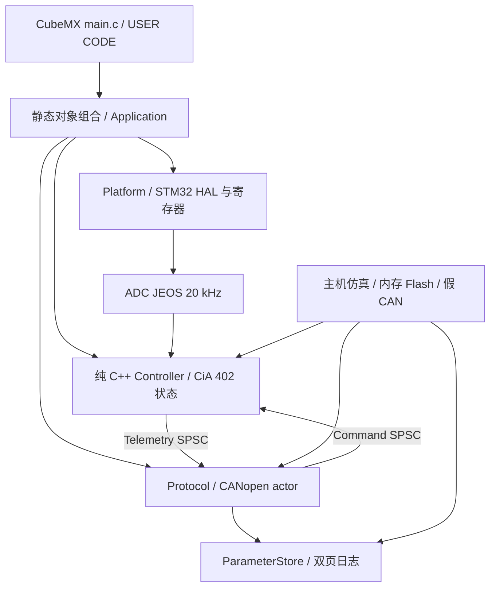

# 架构与并发

## 分层

`Application/include/roller` 无 HAL/FreeRTOS 依赖，包含控制算法、驱动状态机、固定容量队列和参数日志。`Platform/STM32` 负责板级 I/O；`Protocol/CANopen` 负责帧与对象字典，不能直接改 ISR 内控制器的状态。`application.cpp` 是唯一组合入口，将真实实现注入各接口。

架构借鉴参考 WSL 模板的模块生命周期和失败回滚原则，针对 32 KiB SRAM 使用静态实例，不引入动态工厂、运行时服务定位器或通用事件总线。

## 设计模式的具体用途

| 机制 | 作用 |
|---|---|
| Template Method：`Module::start/stop` | 统一初始化、清理和状态转换，避免不同模块各自遗漏失败路径 |
| 固定容量 `ModuleManager` | 按依赖顺序启动，逆序停止；清理失败时保留依赖，不继续释放仍可能被使用的对象 |
| 状态机 | 明确驱动的 disabled / ready / switched-on / enabled / quick-stop / fault 状态 |
| Adapter / 依赖注入 | CANopenNode 的 C 端口映射到 C++ Board；参数存储映射到 STM32 Flash 或测试内存 |
| 三角函数策略 | 主机使用标准库，STM32 注入 CORDIC sin/cos；运行时仅 ADC ISR 持有 CORDIC |
| `ValidatedCommand` 值类型 | CAN 任务完成范围验证后才能进入命令队列，ISR 接收不可变的已校验副本 |
| 单任务协议处理 | CANopen 所有对象由一个任务持有，OD、SDO、PDO、EMCY 不跨线程直接访问 |
| SPSC 邮箱 | 在明确的单生产者/单消费者边界传递完整值对象 |
| 双页提交日志 | 电源中断时保留上一次已提交配置 |

接口不拥有实现对象，因此基类析构受保护，禁止通过基类指针 delete。模块与 RTOS 任务包装器不可复制；任务、TCB、栈、OD、CAN 缓冲区和控制器均静态分配。C++23 用于 `std::expected` 等可读错误传播；不使用异常、RTTI、协程堆帧、动态容器或全局 new。最终 ELF 检查禁止链接分配器。

## 调度与中断

| 执行单元 | 频率 / 优先级 | 内容 |
|---|---|---|
| EXTI0 | NVIC 1 | nFAULT 立即拉低 PB2，设置原子故障位 |
| ADC1_2 | 20 kHz / NVIC 2 | 读注入 ADC、SSC 编码器、保护、dq 电流 PI、SVPWM；每 20 次执行运动环 |
| FDCAN1_IT0 | NVIC 6 | 最多提取 3 个硬件 FIFO 帧，进入 64 帧 SPSC 队列 |
| CANopen task | 1 ms / RTOS 3 | 最多派发 64 帧，SDO/NMT/SYNC/RPDO/TPDO、发布命令 |
| Supervisor task | 10 ms / RTOS 2 | 检查 ADC 与 CAN 任务均前进，喂 IWDG，读按钮和栈高水位 |
| TIM6 | 1 ms / NVIC 15 | 仅 HAL tick |
| SysTick/PendSV | NVIC 15 | 仅 FreeRTOS |

高优先级 ADC/EXTI 不调用任何 RTOS API。CAN 的全部库回调在 CAN 任务内执行，因此 CANopenNode 的锁宏为空；这项约束不是“任意线程都安全”的声明。更换执行模型时必须同步重做锁与数据所有权。

命令和遥测使用 release/acquire 的 32 位 lock-free 原子索引，不是 `volatile` 共享结构体。队列满时命令方向触发故障并禁止功率输出；遥测可丢弃旧采样，接收端使用最新完整值。硬件错误、队列溢出和按钮通过原子通道请求故障，ISR 独占控制器内部状态。

板级输出在启用 PB2 前再次检查 nFAULT、异步故障和 inhibit，防止 EXTI 抢占后旧控制结果重新开桥。中断间隔超过 75 µs（功率开启时）或 ISR 本次执行超过 45 µs 则关桥。阈值检查不能替代示波器/DWT 实测，特别是 Debug、Flash 操作与其他中断同时发生时。

IWDG 约 250 ms，只有 ADC 与 CAN 任务都持续工作才刷新。监督检测到停滞后锁住 inhibit 并停止喂狗；重启不恢复运行命令。Debug 配置冻结 IWDG 方便诊断，断点本身不是停机手段，带电调试前必须先关桥。

Flash 保存恢复 ADC 时递增采样 epoch，监督器重新建立一次进度基线，下一周期仍须观察到两个执行单元前进。周期任务错过截止时间后跳过过期周期，避免连续补跑而触发队列溢出或虚假的停滞。这个例外仅覆盖明确的采样重启，inhibit 仍无条件禁止输出。

## 控制与坐标

电角度 `wrap(direction × pole_pairs × encoder_angle - electrical_offset)`。A/B/C 相使用三路 Clarke，旋转到 dq；Id 目标为 0，Iq 来自 1 kHz 运动环。PI 采用条件积分与矢量限幅反馈，电压矢量最多 4 V 或母线的 40%，取较小值。

位置和速度对外使用经 direction 修正的转数与转/秒。编码器使用整数圈数加当前绝对角度，避免长期累计 Float32 微小增量后丢失位置变化；最终 Float32 对外值仍受浮点分辨率限制。位置轨迹采用加减速限制与制动距离，速度环转换为 rad/s 误差；MIT 的 Kp/Kd 使用对外转数单位，因此量纲为 Nm/rev、Nm/(rev/s)。转矩千分比对应配置的当前电流上限。正负号及 Kt 都需要实测。

电角校准是显式的 1.2 V 开环流程：对齐 0.5 s、扫四个电周 6 s、停稳 0.5 s 后计算极对数、方向和偏移。多圈位移减小齿槽转矩和初始对齐偏差对极对数估计的影响。必须处于 NMT Pre-operational；NMT Stop/Start、过流、编码器异常或无法跟随都会中止，完成后仍然关桥。

20 kHz 控制与板层源文件在 Debug/Release 都使用 `-O2` 并保留调试信息和浮点有限性检查；其余代码分别采用 `-Og`/`-Os`。使用完整 newlib 的优化内存拷贝；原 nano 的逐字节 `memcpy` 在命令/遥测复制时开销明显。CORDIC 配置为 6 cycles、Q1.31、两个输入/输出，上电与标准 sin/cos 对照 257 个角度后才允许采样启动。电流 PI 现为 Kp=2、Ki=600；速度 PI 保留 Kp=0.06、Ki=0.15（误差为 rad/s），见实机对比记录。

## 参数生命周期

Flash 最后两页 62/63（`0x0801F000` / `0x0801F800`）保留给日志，独立 linker 仅给程序 124 KiB Flash。每条记录包含长度、序号、版本、CRC、payload；CRC 同时保护前三个元数据字段和 payload。先写非活动页，最后写 64 位提交字。

单 Bank G431 写 Flash 可能阻塞取指，保存仅允许非运行状态且控制字为 0；板层再检查 PB2 为低，然后暂停 ADC/PWM、写入、恢复采样。保存的通信与运动限制来自白名单；控制字、目标位置/速度/转矩、MIT 帧和校准请求不在恢复白名单中。节点号和电流/Kt 参数在保存并重启后应用；校准结果可立即用于本次上电，只有显式保存才跨重启保留。

持久化 schema 目前为版本 1，包含当前构建的 `SavedSettings` 布局。修改该结构或 OD 布局时应升级 schema 并提供迁移，或有意让旧参数失效重新校准；不能直接把未知旧固件的 Flash 页当作有效参数。
