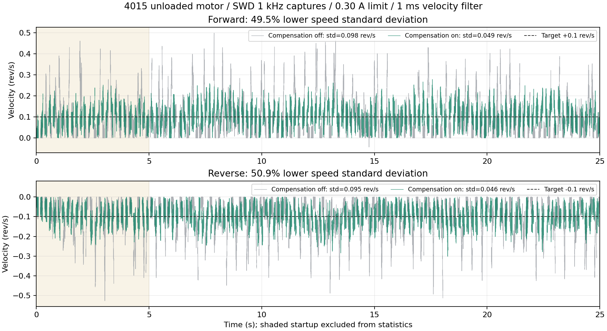

# 4015 电机调试记录 · 2026-11-17

本文保留首轮校准和补偿试验的历史配置及数据。当前固件的测速、增益、高速补偿渐退与新增验收见 [第二轮性能优化记录](motor-performance.md)。

用户确认电机已固定、保持空载，授权带电校准和运动测试；暂未连接 CAN 收发器。本次使用 ST-Link/OpenOCD 和 Bench 的 CANopen SWD 邮箱完成控制，未跳过状态机直接修改控制器内部目标。板上保留 Bench 固件，测试结束后回 Pre-operational、控制字 0、PB10 低、三相 PWM 关闭，不会重启自动运行。

## 已确认的模式与修改

工程原本已有单圈最短路径位置（-1）、多圈位置（1）、速度（3）、力矩（4）、MIT（5）。本轮完善并实测这些模式共用的采样、校准和控制链路，没有重复实现另一套协议。

- 电流零点增加均值范围、噪声、相间差异、超时和失败锁存；未建立可靠零点时禁止校准/使能。
- 旧 PWM 提交窗口在校准计算结束时可能已关闭，导致一直延期、三相无法连接。现在控制 ISR 发布请求，TIM1 下溢提交预装载、再下溢统一锁存；TIM1 优先级提高到 1，ADC/SSI 为 2，TIM1 不访问 Controller。
- 校准加入三方向电流响应检查、完整机械圈正反扫描、分段位移、电流和返回闭合检查。正常约 17.6 s；测补偿用慢扫描约 201.6 s。
- 驱动唤醒完成前复位电流 PI，防止积分积累；唤醒状态锁存，避免 DWT 周期计数器回绕后误判。
- 速度 PI 使用 `Kp=0.06、Ki=0.5`，误差单位 rad/s、输出 A；速度差分滤波时间常数 1 ms。实测 2 ms 滤波时某位置发生小幅振荡，缩短到 1 ms 后本轮位置保持测试稳定。
- 增加 1024 点角度周期电流补偿、离线拟合工具、补偿开关、1 kHz 冻结轨迹和有电流限制的 SWD 验收脚本。

## 接线修复与校准证据

最初 PB10 松线时，静止原始 ADC 约 3420/3550/3632，电流零点失败为 `0x5210`；此时没有把这些读数作为有效电流继续运动。用户重新接好后，零点恢复到约 2044/2046/2047，窗口峰峰值约 14～22 counts，电流反馈验证通过。

| 项目 | 实测结果 |
|---|---|
| 母线 | 约 19.35 V |
| 电机 | 4015，11 极对，空载 |
| 普通双向整圈校准 | 成功；方向 +1，电角偏置 3.130120754 rad，集中度 0.9711 |
| 保存与重启 | 通过 `0x1010:01=save` 保存普通校准；重启加载正确 |
| 慢速正反整圈扫描 | 成功；偏置 3.134238958 rad，集中度 0.9847，累计 190000 个偏置点 |
| 两种扫描偏置差 | 约 0.00412 rad 电角（0.24° 电角） |
| 慢扫返程闭合误差 | 约 0.01956 rad 机械角（1.12°） |
| 编码器 | 本轮运动统计中 missed=0 |

慢扫描得到的偏置用于拟合坐标转换；Flash 中保留已经保存并验证的普通校准结果。两者差异在补偿表允许的 0.1 rad 电角匹配范围内。校准仍使用已知 R/L/Kt 初值，不是绕组参数和轴端力矩的自动辨识。

## 运动验收

所有试验电流目标上限为 0.30 A，约 19.35 V 供电，每项 5 s。下表统计最后 35% 的遥测窗口，位置误差按发令前原点解析；所有样本必须保持 Operation enabled、fault=0。原始低速快照不适合分析高频波动，补偿对比另用 1 kHz 轨迹。

| 试验 | 稳态结果 | 结论 |
|---|---|---|
| +0.1 rev/s（6 rpm） | 均值 +0.0795，标准差 0.0469 rev/s | 通过 |
| -0.1 rev/s | 均值 -0.1108，标准差 0.0437 rev/s | 通过 |
| +0.5 rev/s（30 rpm） | 均值 +0.5136，标准差 0.0808 rev/s | 通过 |
| -0.5 rev/s | 均值 -0.5070，标准差 0.0616 rev/s | 通过 |
| 单圈相对 +0.125 rev | 稳态最大误差 0.000061 rev（0.022°） | 通过 |
| 单圈相对 -0.125 rev | 最大误差 0.000732 rev（0.264°） | 通过 |
| 多圈相对 +1.25 rev，0.5 rev/s | 最大误差 0.001526 rev（0.549°） | 通过 |
| 多圈相对 -1.25 rev，0.5 rev/s | 最大误差 0.000488 rev（0.176°） | 通过 |
| MIT 相对 +0.08 rev | 最大误差 0.015852 rev（5.71°） | 通过，有静态偏差 |
| MIT 相对 -0.08 rev | 最大误差 0.001448 rev（0.52°） | 通过 |

MIT 使用 `Kp=1 Nm/rev、Kd=0.08 Nm/(rev/s)`，前馈速度/力矩均为 0。MIT 是无位置积分的阻抗控制，静摩擦会产生静态位置偏差；不能据此宣称与位置伺服一样精确。这些单位是机械圈，不能直接套用以 rad 为单位的 MIT 参数。Kt=0.23 Nm/A 仍为资料初值，未使用力矩仪确认。

验收阈值预先写在 `motor_acceptance.py`：速度均值误差不超过 `max(0.03 rev/s, 20%)`，标准差不超过 `max(0.05 rev/s, 30%)`；位置/MIT 最终窗口误差不超过 0.02 rev、速度绝对值不超过 0.1 rev/s。此次 10/10 通过。位置模式的实际误差显著小于该宽松空载门槛；仍未验证任意角度、负载和全速度范围。

## 补偿对比

慢扫描各方向覆盖一整圈，拟合前将定子坐标系 id/iq 转换到校准后的转子坐标系，分离方向相关摩擦和角度周期项。拟合残差 RMS 约 0.00974 A，原始周期表峰值约 0.1252 A；应用增益 0.8，实际补偿峰值约 0.1002 A。总电流限幅在叠加之后执行，速度积分器跟踪饱和结果。

最终 1 ms 滤波固件分别在正反 0.1 rev/s 下关闭/开启补偿，各运行 25 s。每次读取 96 点连续 1 kHz 冻结轨迹，采集批次之间有空隙；剔除前 5 s，每组统计约 1 万点，覆盖约两圈稳态运动。

| 方向 | 补偿关闭：均值 / 标准差 | 补偿开启：均值 / 标准差 | 标准差降低 |
|---|---|---|---|
| +0.1 rev/s | +0.09823 / 0.09768 | +0.10381 / 0.04930 | 49.5% |
| -0.1 rev/s | -0.09936 / 0.09465 | -0.09772 / 0.04647 | 50.9% |



补偿改善了低速表现，但没有消除全部波动。表中低次谐波可能也包含编码器偏心、非线性和摩擦残余，所以它是本安装条件下经运动对比验证的周期电流前馈，不能当成纯齿槽力矩测量。断电时软件补偿不生效，手转感到的磁槽阻力仍然存在。

表固化在 `Application/include/roller/control/cogging_map.hpp`，使用原始编码器机械角作为索引，与电机和编码器安装绑定。默认开启；极对数/方向不匹配或电角偏置差超过 0.1 rad 时返回零。该检查不能识别所有机械安装变化，更换电机、移动编码器/磁铁后须主动关闭并重新测量。开关只在 RAM 中，重启默认开启。

## 无 CAN 收发器时的操作

在工程根目录启动 OpenOCD：

```powershell
openocd -f tools/rollercan-openocd.cfg
```

另一个终端运行以下命令。当前已烧录 Bench，ELF 必须与板上固件匹配。不要把多个控制脚本同时连接到同一邮箱。

```powershell
python tools/stlink_bench.py inspect
python tools/stlink_bench.py stop
python tools/stlink_bench.py --output .work/calibration.json calibrate --save
python tools/stlink_bench.py velocity 0.1 --seconds 5 --current-limit 0.3
python tools/stlink_bench.py position 0.125 --relative --speed 0.5 --seconds 5
python tools/stlink_bench.py multi-position 1.25 --relative --speed 0.5 --seconds 5
python tools/stlink_bench.py mit --position 0.08 --relative --kp 1 --kd 0.08 --seconds 5
python tools/motor_acceptance.py --output .work/acceptance.json
```

重新采集与拟合补偿（numpy 只在离线拟合时需要）：

```powershell
python tools/stlink_bench.py --output .work/slow-scan.json calibrate --slow
python tools/fit_cogging.py .work/slow-scan.json --header Application/include/roller/control/cogging_map.hpp --report .work/cogging-fit.json
./tools/build.ps1 -Preset Bench
# 重新烧录并校验后，再做开/关对比。
python tools/stlink_bench.py cogging off
python tools/motor_trace.py 0.1 --seconds 25 --output .work/off.json
python tools/stlink_bench.py cogging on
python tools/motor_trace.py 0.1 --seconds 25 --output .work/on.json
```

慢扫不自动生成表，也不自动保存参数；拟合只写源文件，不直接更改运行中的 MCU。拟合通过并不等于运动性能改善，重新拟合后仍须做双向对比。通信失联继续保持最后目标是原工程明确策略，停止须用 `stop` 或 NMT Stop；脚本正常退出和异常退出都会尝试停止。

## 验证与数据

Host 三项 CTest、39 项 Python 测试通过；Bench、Bringup、Debug、Release 均构建成功并通过静态分配/外设约束检查。本轮实测最大控制回调时间为 6661 cycles / 160 MHz ≈ 41.63 µs，低于 50 µs 周期；这不是所有工况的 WCET 证明。Bench RAM 30056 B / 32 KiB，Release RAM 27464 B / 32 KiB；Bench 额外保留 1 kHz 轨迹缓冲。

最终从 Flash 读回程序区，与 `build/Bench/canopen_foc.bin` 逐字节一致（SHA256 `311d7c1464523f5d47ee30bd8aa200917085d814dbfacddcac26667610241eda`）。重启再次确认零点有效、已保存偏置正确、fault=0，最后执行显式停止并检查 nSLEEP/PWM 均关闭。

可版本化摘要见 [JSON 验证记录](motor-validation-20261117.json)。完整原始数据保留在本机 `.work/motor-20261117/`，不纳入 Git：

- `original-flash.bin`：调试前完整 Flash 备份。
- `calibration-3.json`、`calibration-saved.json`：普通校准和保存证据。
- `cogging-scan.json`、`cogging-fit.json`：慢扫描和拟合结果，源数据 SHA256 也写入补偿头文件。
- `acceptance-tau1.json`：最终 10 项运动验收及全部低速快照。
- `final-positive-off/on.json`、`final-negative-off/on.json`：最终 1 kHz 补偿对比原始轨迹。
- `final-verification.json`、`final-readback.bin`、`final-idle-hardware.json`：最终读回、重启和停止状态证据。

当前完成的是约 19.35 V、空载、0.3 A 上限下的上述运动验证。物理 CAN/CAN-FD 总线、带载温升、轴端力矩精度、高速电压饱和区、示波器采样建立时间尚未验收。驱动板未连接 nFAULT，报告的温度是 MCU 温度；软件不能读取未接入的驱动故障引脚或未知参数的绕组 NTC。
