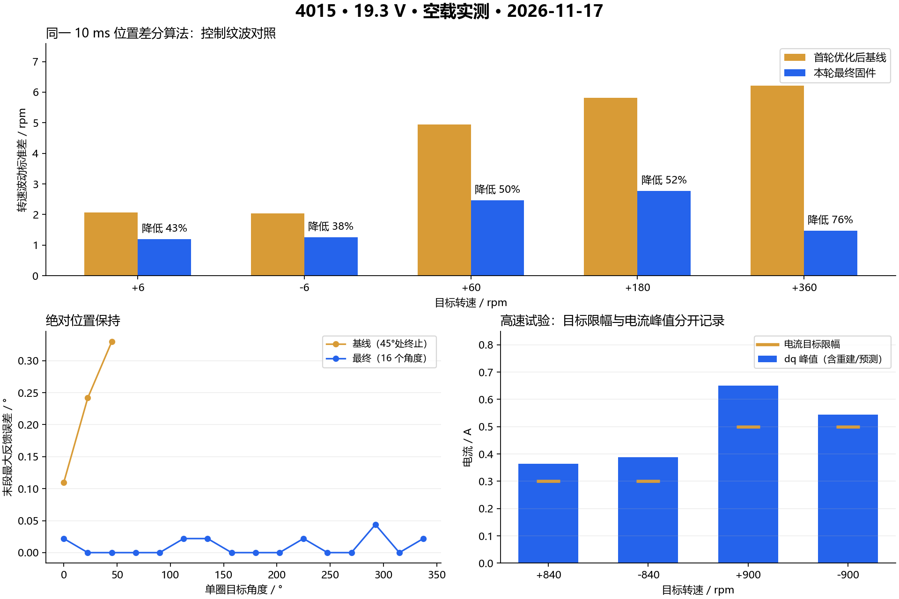

# 第二轮电机性能优化 · 2026-11-17

本轮在用户确认固定、空载的 4015 电机上通过 ST-Link/OpenOCD 和 Bench 邮箱执行。母线约 19.3 V，11 极对，电角偏置保持 3.130120754 rad。基线是首轮优化后的实际固件，先读回完整 Flash 并确认程序与原 ELF/BIN 一致；末尾又恢复原固件做位置对照。原始数据、各候选 ELF/BIN 和备份保存在本机 `.work/motor-performance-20261117/`，不纳入 Git。

## 最终控制配置

- 测速采用约 1 ms 的局部角增量窗口，再做 0.25 ms 低通；每 20 次更新重新求和，消除长期运行后停转的浮点残留假速度。低频等效延迟约 0.75 ms。
- 速度 PI 的 Kp 随内部速度轨迹在 0～1 rev/s 内从 0.03 增至 0.06，Ki=3.0；误差单位 rad/s、输出 A。位置外环比例从 10 提高到 20 s⁻¹。积分状态不会随增益调度被清零。
- 电流 PI 标称整定频率从 500 提高到 800 Hz，Kp=L·2π·800、Ki=R·2π·800。800 Hz 是整定参数，未通过频响注入证明实际带宽。
- 原 1024 点、0.8 增益周期补偿表保持不变。查表从 1 kHz 改到 20 kHz，按 PWM 传输延迟与电流环时间常数预测角度；≤1 rev/s 全量，1～6 rev/s 线性渐退，≥6 rev/s 归零。合并后总电流目标限幅，速度积分器在 1 kHz 跟踪饱和。
- 电流预测的有效反电动势系数改为 0.104 V/(机械 rad/s)，与外部力矩接口 Kt=0.23 Nm/A 分开。MIT 阻抗公式、CANopen 对象字典、Flash 参数结构均保持原语义。

直接增加速度比例增益的候选会激起约 90 Hz 振荡，因此未保留。低速使用的周期表包含编码器和摩擦残余：14 rev/s 的同固件开/关对照中，10 ms 位置差分速度标准差由 0.15786 降至 0.07881 rev/s，支持高速渐退；此表不能视作所有速度下的纯齿槽力矩模型。

## 速度对照

每批为 96 个连续 1 kHz 样本，批次之间有 SWD 读出空隙。稳态统计剔除前 5 s，全部使用 0.30 A **目标**限幅。由于测速滤波改变，主要比较在两版原始位置上使用完全相同的 `(p[n+10]-p[n])/0.01` 算法得到的标准差；只在同一批内求差分，绝不跨空隙计算。另列固件速度估计的标准差，不把两种指标混为一谈。

| 目标 rpm | 位置差分标准差：原版 → 最终 rpm | 降低 | 固件速度标准差：原版 → 最终 rpm | 最终均值误差 rpm |
|---|---|---|---|---|
| +6 | 2.071 → 1.190 | 42.5% | 2.844 → 1.770 | +0.115 |
| -6 | 2.034 → 1.258 | 38.2% | 2.788 → 1.785 | -0.058 |
| +60 | 4.951 → 2.471 | 50.1% | 6.639 → 4.504 | -0.149 |
| +180 | 5.815 → 2.776 | 52.3% | 7.842 → 6.308 | +0.263 |
| +360 | 6.218 → 1.468 | 76.4% | 7.460 → 7.647 | +0.012 |

360 rpm 时固件速度估计的全带宽标准差略增，但同口径 10 ms 位置差分指标明显改善；不宣称所有频段纹波均下降。各次采样约 8～20 s，稳态样本数和原始文件 SHA256 见 JSON。

## 高速范围与电流边界

| 目标 rpm | 电流目标限幅 A | 均值误差 rpm | 10 ms 位置差分标准差 rpm | dq 电流峰值 A | 指令电压利用率峰值 |
|---|---|---|---|---|---|
| +840 | 0.30 | -0.042 | 4.753 | 0.364 | 90.0% |
| -840 | 0.30 | +0.114 | 4.842 | 0.389 | 89.6% |
| +900 | 0.50 | +0.030 | 5.464 | 0.650 | 95.6% |
| -900 | 0.50 | +0.015 | 5.480 | 0.545 | 95.7% |

±840 rpm 每项 16 s，±900 rpm 每项 18 s，另有按 2 rev/s² 加减速的过程。900 rpm 在 0.30 A 目标上限时曾因 dq 峰值超过测试门槛 0.55 A 停止；最终 **单独采用 0.50 A 目标上限、0.85 A 测试峰值门槛** 才完成双向验证。这不是证明原 0.30 A 工况已修好，也不是修改固件硬件保护阈值。该点电压利用率接近 96%，电流有重建/预测成分；目标限幅不等于实际相电流峰值限制，不作为带载或持续运行能力保证。

## 位置与 MIT

绝对单圈位置每隔 22.5° 测一个点，每点约 3 s，统计末段约 1 s 的 1 kHz 冻结样本。原版在第三个点 45° 的速度 RMS 达 0.187 rev/s、位置摆幅 0.505°，触发预先规定的保持门槛后终止；**原版只取得 3 个点，不能宣称已完成 16 点配对比较**。

| 共有角度 | 原版最大反馈误差 ° | 最终最大反馈误差 ° |
|---|---|---|
| 0° | 0.1099 | 0.0220 |
| 22.5° | 0.2417 | 0.0000 |
| 45° | 0.3296 | 0.0000 |

最终版 16/16 个点完成，最大反馈误差 **0.0439°**，约两个 14 位编码器计数。另有原有 10 项速度、单圈/多圈位置、MIT 验收全部通过；相对位置验收仍按发令前的反馈原点解析，因此与这组绝对角度保持测试口径不同。

MIT 使用相同预定位角度，再分别测试两组参数，每项 5 s、0.30 A 电流目标限幅。预定位后会失能等待停稳，原点按实际反馈重新取样，目标存在少量原点差异。

| 相对运动 | Kp=1、Kd=0.08：末段最大误差 ° | Kp=3、Kd=0.04：末段最大误差 ° |
|---|---|---|
| +0.08 rev | 5.289 | 1.356 |
| -0.08 rev | 0.558 | 0.273 |

Kp 单位 Nm/rev，Kd 单位 Nm/(rev/s)。`Kp=3、Kd=0.04` 是本安装条件下试过的一组较高刚度参数，需要主站显式发送；没有修改 MIT 默认值或给阻抗控制偷偷加入位置积分。静摩擦静差仍存在。反馈误差都以板载 MT6701 为基准，未用独立轴角度或力矩传感器证明绝对机械精度。



## 电流预测参数辨识

在正向 6/9/12 rev/s、反向 6/12 rev/s 的完整三相有效帧中，以指令电压和母线重建 Vq，拟合 `Vq-R·Iq-ωe·L·Id = Ke·ωm + V0·sign(ωm)`。五个平台共 156 个稳态快照，Ke=0.1038303 V/(机械 rad/s)、V0=0.11220 V，平台残差 RMS=0.01757 V。它依赖现有 R/L、角延迟和电压估算，未做绕组独立辨识；也不能据此确认资料 Kt 的峰值/RMS 约定。`tools/fit_back_emf.py` 可重算，输入和哈希见 JSON。

## 复现与验证

需要匹配已烧录 Bench 的 ELF 和运行中的 OpenOCD。不要同时启动多个控制脚本。

```powershell
python tools/motor_trace.py 0.1 --seconds 20 --cogging on --output .work/low-speed.json
python tools/motor_trace.py 14 --seconds 16 --current-limit 0.3 --output .work/high-speed.json
python tools/motor_trace.py 15 --seconds 18 --current-limit 0.5 --output .work/900rpm.json
python tools/motor_position_sweep.py --points 16 --seconds 3 --output .work/positions.json
python tools/motor_acceptance.py --output .work/acceptance.json
python tools/stlink_bench.py mit --position 0.08 --relative --kp 3 --kd 0.04 --current-limit 0.3 --seconds 5
python tools/stlink_bench.py stop
```

`motor_trace.py` 接受固件协议范围 ±40 rev/s，但这只是参数合法范围，不表示该硬件已验证到 2400 rpm。它在运动前检查停稳、零点、母线及电流限值；运行中检查状态、速度和 dq 电流幅值，正常结束先降至零速，异常退出立即停止，并保留未完成报告。

Host 三项 CTest、48 项 Python 测试通过；Bench、Bringup、Debug、Release 均构建并通过约束检查。最终 Bench RAM 30256 B / 32 KiB，Release 27648 B / 32 KiB。最终固件实测控制 ISR 最大 7233 cycles / 160 MHz = 45.21 µs，低于 50 µs 周期；不是所有异常路径的 WCET 证明。上述最终运动试验故障码和编码器丢帧计数均为 0。

最终 Flash 程序逐字节读回一致，BIN SHA256 `e4fb387c7a8de5a0b105aff4e6dcf385ad707b4eace1e275277398c2c3f5cba5`。参数区与调试前完整备份逐字节相同；重启后电流零点有效、原校准正确，最后显式停止，PB10 低、PWM 通道为 0。

结构化摘要及所有比较所用原始文件哈希：[motor-performance-20261117.json](motor-performance-20261117.json)。原始逐样本数据、失败候选、完整 Flash 备份和重启读回证据在本机 `.work/motor-performance-20261117/`。
