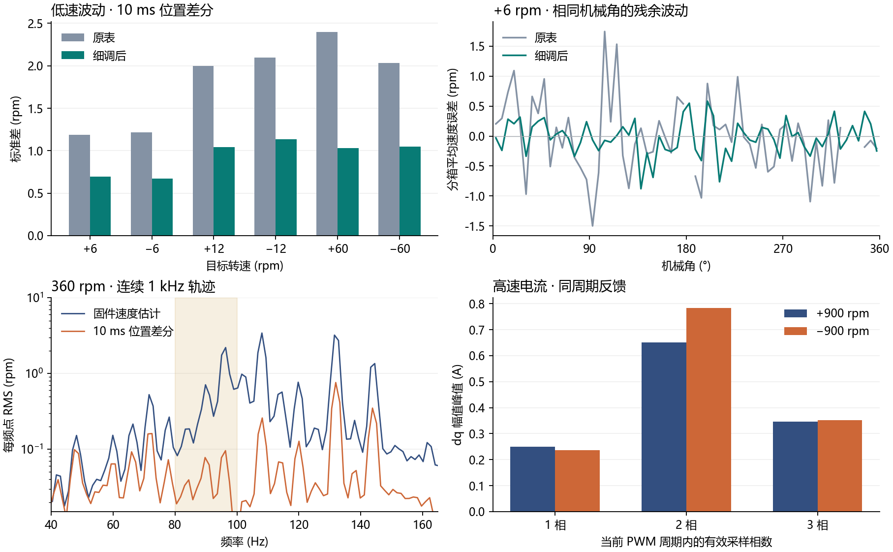

# 4015 电机空载台架记录 · 2026-11-18

硬件为 STM32G431、DRV8316C 和 14 位 MT6701，母线约 19.3 V。运动指令通过 ST-Link 的 CANopen Bench 邮箱发送。本次测量的角度、电流和温度来自板载传感器。轴上保持空载。

## 低速与周期电流补偿

用上一轮最终版和本日原表版本的 ±6 rpm 稳态轨迹训练。按预测机械角从总 q 轴电流目标减去原表前馈，按机械角分箱等权拟合正、反向反馈。两方向的常数项单独估计，共同周期项取 0.8 倍修正。最终 1024 点表约束为零均值，保留原表的电流峰值。训练文件和独立验证文件的哈希保存在结构化记录中。

共同项中，每机械圈重复 2 次和 1 次的分量最大，其后是 48、22 和 66 次。修正量峰值 0.0608 A，整表峰值 0.10016 A。留出的 ±12 rpm 原表轨迹上，扣除候选修正后的正、反向反馈残余标准差分别为 0.0105、0.0103 A。下表是另行烧录后的独立运动试验。

各项电流目标限幅 0.30 A。每批 96 个 1 kHz 样本，SWD 读出期间有间隔。剔除启动段后，只在连续批内对相隔 10 个样本的位置求差。原表与最终表均按同一方法计算。

| 目标 rpm | 原表 10 ms 标准差 rpm | 最终 10 ms 标准差 rpm | 降幅 | 最终固件测速标准差 rpm | 最终均值误差 rpm |
|---:|---:|---:|---:|---:|---:|
| +6 | 1.188 | 0.693 | 41.7% | 1.478 | -0.014 |
| -6 | 1.215 | 0.672 | 44.7% | 1.461 | +0.030 |
| +12 | 2.001 | 1.044 | 47.8% | 1.643 | +0.024 |
| -12 | 2.097 | 1.135 | 45.9% | 1.685 | +0.003 |
| +60 | 2.398 | 1.032 | 57.0% | 3.372 | -0.010 |
| -60 | 2.031 | 1.048 | 48.4% | 3.330 | +0.050 |



## 方向相关摩擦与 MIT

±6 rpm 稳态的方向偏置为 +46.5 / -46.0 mA。半差 46.2 mA 是空载运动中的方向相关电流估计。按配置 Kt=0.23 Nm/A 折算约 10.6 mNm，仍缺少轴端力矩标定。

固定 MIT 绝对目标为 45° 或 225°，各从正、负两个方向接近。每次先用位置环预定位到目标前后 0.08 圈，再用 Kp=1 Nm/rev、Kd=0.08 Nm/(rev/s) 保持 2.6 s。分别发送 0 或沿接近方向的 5 mNm 前馈，交替试验顺序并各重复两次。表中为末 1 s 的最大绝对误差，两数对应两次重复。

| 目标角 | 接近方向 | 零前馈 ° | 有前馈 ° |
|---:|---:|---:|---:|
| 45° | +1 | 2.77 / 2.75 | 0.73 / 0.79 |
| 45° | -1 | 4.44 / 4.42 | 1.36 / 1.38 |
| 225° | +1 | 1.63 / 1.58 | 0.48 / 0.42 |
| 225° | -1 | 4.88 / 4.86 | 1.43 / 1.49 |

8 组配对的末段最大误差均减小。各次最大误差的中位数由 3.59° 变为 1.08°。MIT 前馈由主站显式设置。

## 900 rpm 下的同周期峰值

电流目标限幅 0.50 A。每个窗口在板上逐 PWM 周期检查连续 2000 帧，按 3 位有效相掩码累计帧数、平方和，以及最大 dq 幅值的完整样本。CCR 是产生本次 ADC 采样窗口的已锁存占空比，电角度是本帧 Park 变换所用角度。每方向 32 个窗口共 64000 帧，窗口之间有 SWD 读出间隔。

| 方向 | 1 / 2 / 3 相有效占比 | 1 / 2 / 3 相反馈峰值 A | 最大峰值时有效相 | 当时 A / B / C 占空比 | 电角度 | 同帧有效电压利用率 |
|---:|---:|---:|---:|---:|---:|---:|
| +900 rpm | 0.41% / 79.51% / 20.08% | 0.249 / 0.651 / 0.346 | AC | 56.2% / 95.7% / 4.3% | 357.1° | 91.7% |
| -900 rpm | 0.17% / 80.49% / 19.34% | 0.236 / 0.784 / 0.353 | AC | 37.6% / 99.4% / 0.6% | 181.8° | 99.8% |

最终版稳态采集起止快照的位置与板端时间差给出平均转速 +899.998 / -900.002 rpm。另一轮同样的双向采样在细调候选版上分别记录到 0.770 A 和 0.753 A，同样都在两相有效帧。各轮最大值随采到的窗口而变化。

两相有效时，观测器直接使用两个采样值并由三相电流和为零补出第三相。应优先用外部电流探头对齐这类帧的有效相采样与第三相重建。当前仅有 ST-Link，板载记录无法独立判定实际绕组峰值、模拟前端建立误差或重建误差。ADC 触发位置与电流观测器参数沿用基线设置。

## 长行程与反馈精度

在最终固件上以 720 rpm、0.30 A 目标限幅进行长行程。起止绝对计数 4742 和 163961277，净行程 **10007.1127 圈**，用时 843.3 s。累计 0 次编码器丢样，MCU 温度最高 32°C。每约 30 s 抽取 100 ms 全 PWM 窗口，抽检 dq 峰值 0.346 A。

到达该位置后，在同一次上电期间用多圈相对指令依次发出小步进。目标按板端 setpoint ACK 生效帧的实际计数加上指令增量解析。以下误差直接用编码器计数求得，统计每个连续窗口末 150 ms。一个计数等于 0.0219727°。

| 请求增量 counts | 由 ACK 帧解析的目标 counts | 末段反馈减目标 counts |
|---:|---:|---:|
| +17 | 163961288 | +1 至 +1 |
| -17 | 163961258 | +0 至 +0 |
| +1 | 163961269 | +0 至 +1 |
| -1 | 163961265 | +0 至 +0 |

Host 回归还使用正常控制器入口模拟正负 10000 圈，检验单计数 MIT 刚度响应、相对位置目标、到位位和小数计数轨迹积分。真实轴角的绝对精度仍以外部角度计为验收依据。CANopen REAL32 绝对指令和 0x6064 反馈在 10000 圈附近仍有 16 counts 的量化间隔，细步进可使用多圈相对命令。

## 换向、位置响应和 90 Hz 频带

连续运动记录每段 768 个 1 kHz 样本，编码器位置按整数计数展开，速度估计的台架记录分辨率约 0.117 rpm。指令生效时刻以板端控制字确认或速度指令符号标记。到带时间指从生效到进入容差并保持至记录末端，末段至少覆盖 50 ms。

| 运动 | 测量口径 | 结果 |
|---|---|---|
| +60 → -60 rpm，10 rev/s² | 10 ms 差分峰值超调，±3 rpm 容差 | 2.26 rpm，199 ms |
| -60 → +60 rpm，10 rev/s² | 10 ms 差分峰值超调，±3 rpm 容差 | 2.62 rpm，199 ms |
| +21.6° 位置阶跃，0.4 rev/s 上限 | ±0.1° 容差，峰值超调 | 237 ms，0.022° |
| −21.6° 位置阶跃，0.4 rev/s 上限 | ±0.1° 容差，峰值超调 | 235 ms，0.022° |

每个稳态频谱对 6 段记录各自去均值、加 Hann 窗，按窗能量归一后平均单边功率，再对 80～100 Hz 积分取平方根。固件速度频点间隔为 1.302 Hz。两个位置差分口径按相同的样本终点计算，三个转速均使用最终烧录版。

| 转速 rpm | 固件带内 RMS rpm | 带内最强频点 Hz | 位置 1 ms / 10 ms 带内 RMS rpm |
|---:|---:|---:|---:|
| 300 | 5.121 | 89.84 | 5.192 / 0.502 |
| 360 | 3.246 | 96.35 | 3.322 / 0.185 |
| 420 | 2.332 | 84.64 | 2.360 / 0.315 |

另在 MIT 保持状态记录 ±4.6 mNm 指令前馈脉冲。板端正、负脉宽为 172 / 187 ms，最大偏移 0.132° / 0.132°。撤去指令至回到脉冲前位置 ±0.1° 的时间为 5 / 6 ms。该试验测量控制指令扰动和静摩擦共同作用下的轴位置。台架未接负载执行器，已知轴端负载扰动的恢复时间仍待测。

## 验证和复现

Host 3 项 CTest、55 项 Python 测试通过，Bench、Bringup、Debug、Release 均通过构建与工程检查。原有 10 项运动验收通过 10/10。最终固件各轮记录到的控制 ISR 最大 7400 cycles（46.25 µs），控制周期 50 µs。

SWD 初期出现过读写失败和不一致的冻结缓冲区。脚本对冻结数据做重复校验，Bench 支持启用 600 ms 的 SDO 续期，失联时经 NMT Stop 关桥。未完成的采集保留在原始目录。最终程序和参数区均逐字节读回校验。BIN SHA256 为 `1830eaba79ea8d8ab579def650955c391a443fc7920c9ac442fcf6c012f97ef9`。重启后零点有效、校准加载正确，已确认 PB10 和三个 PWM 通道均关闭。

原始试验和 Flash 备份位于本机 `.work/motor-response-20261118/`。结构化摘要含使用的原始文件哈希和被排除的采集。[数据摘要](motor-response-20261118.json)

本机最终采集使用 OpenOCD 的 ST-Link DAP 驱动。先在工程根目录启动服务，再在另一终端用与板上程序匹配的 Bench ELF 运行采集。

```powershell
openocd -f interface/stlink-dap.cfg -c "transport select dapdirect_swd" -f target/stm32g4x.cfg -c "bindto 127.0.0.1" -c "telnet_port disabled" -c "adapter speed 1800"
```

```powershell
python tools/motor_trace.py 0.1 --cogging on --seconds 48 --output .work/low-pos.json
python tools/motor_response.py spectrum 6 --windows 6 --output .work/spectrum.json
python tools/motor_response.py current 15 --current-limit 0.5 --windows 32 --output .work/peaks.json
python tools/motor_response.py reversal 1 --output .work/reversal.json
python tools/motor_response.py position 0.06 --output .work/step.json
python tools/motor_friction.py --output .work/mit-friction.json
```

下列命令使用归档的原表与轨迹重算候选表。采集、烧录和离线拟合可分别执行。

```powershell
$trial = '.work/motor-response-20261118'
$prior = '.work/motor-performance-20261117'
python tools/fit_cogging_residual.py --base "$trial/slow-map.hpp" `
  --train "$prior/final-positive-01.json" "$prior/final-negative-01.json" "$trial/stock-pos6.json" "$trial/stock-neg6.json" `
  --validate "$trial/stock-pos12.json" "$trial/stock-neg12.json" `
  --header "$trial/replay-map.hpp" --report "$trial/replay-fit.json"
```
